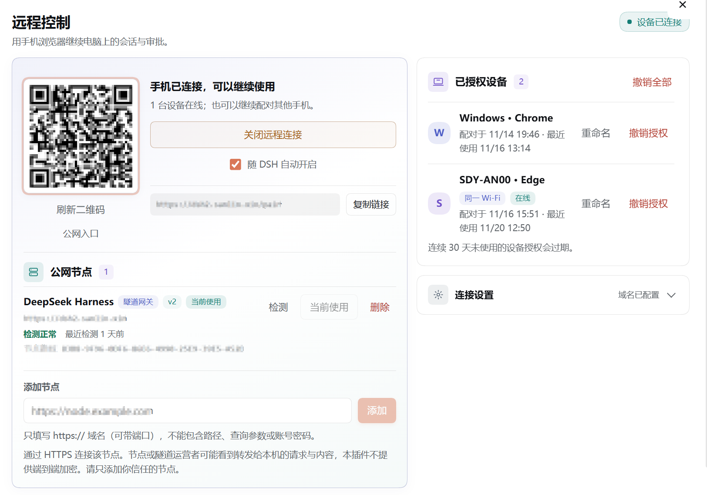
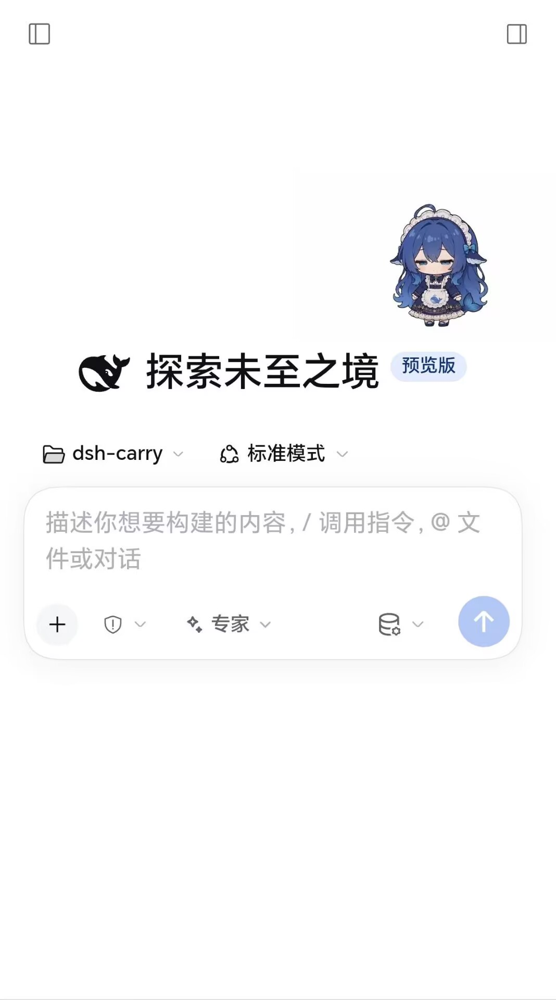
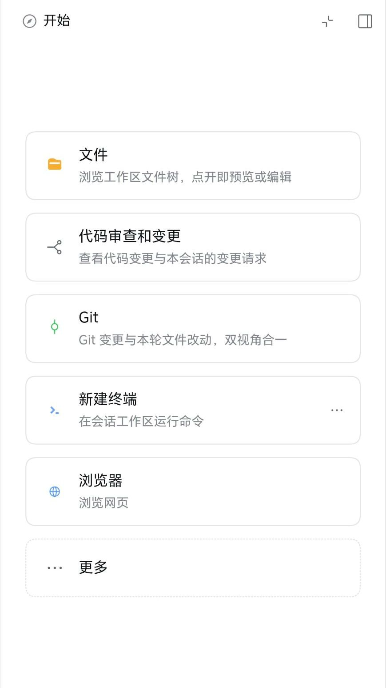
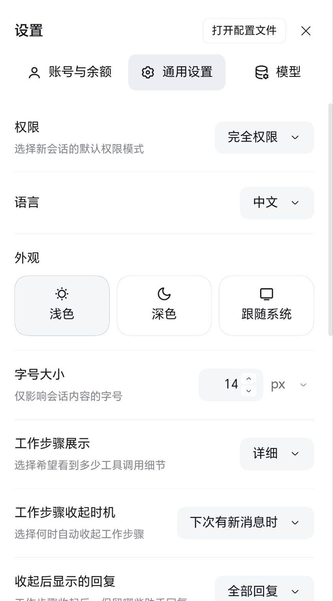

# DSH 远程连接

用手机浏览器继续电脑上的 **DeepSeek Harness（DSH）** 会话：扫码配对，发送消息，查看工具执行并确认审批，也能打开电脑上的文件预览。

适配 **DSH 0.2.2 系列**，当前验证基线为 **0.2.2-rc.3**。基于 [copylee711/dsh-remote-control](https://github.com/copylee711/dsh-remote-control) 修改，保留原项目署名与 MIT 许可证。

## 界面预览

<p align="center">
  
</p>

<p align="center"><strong>电脑上：开启连接、扫码配对、管理已授权设备</strong></p>

<p align="center">
  
  &nbsp;&nbsp;
  
</p>

<p align="center">
  
  &nbsp;&nbsp;
  
</p>

<p align="center"><strong>手机上：新会话</strong> · <strong>对话</strong> · <strong>工作区工具</strong> · <strong>通用设置</strong></p>

插件自身的界面就是电脑端的这个面板：局域网 / 公网入口、二维码配对、已授权设备的查看与重命名撤销都在这里。配对完成后，手机浏览器加载的是电脑宿主本身的界面——选择工作区与模型、继续对话，或调整语言、主题和字号，界面由电脑上的 DSH 版本及已启用扩展共同决定。

## 功能一览

| 功能 | 使用方式 |
| --- | --- |
| 同一 Wi-Fi 连接 | 手机与电脑在同一网络，扫码后由电脑确认配对。 |
| 公网连接 | 使用固定 HTTPS 域名与已有转发通道，在其他网络继续访问。 |
| 设备管理 | 查看在线状态、重命名设备、撤销单台或全部设备授权。 |
| 宿主原生界面 | 聊天、设置和自动化使用电脑当前的 DSH Web 界面。 |
| 文件预览 | 从会话链接打开电脑上的 HTML 页面及其资源，或预览普通文件。 |
| 证书管理 | 支持 ACME 申请与续期，并按转发工具的约定部署证书。 |

## 手机打开的就是电脑上的界面

手机浏览器打开远程连接地址时，运行的是**电脑上正在使用的那一份 DSH Web 界面**：

- 电脑升级 DSH 后，手机刷新即加载宿主当前界面，插件不另存一份前端；宿主接口变化时仍需检查插件兼容性。
- DSH 对手机、平板、窄窗口做的适配（软键盘、触屏、窄屏设置页等）随宿主一起生效。
- 插件提供认证网关、扫码配对、局域网 / 公网入口、证书与本机管理面板。

宿主负责视口、键盘策略、状态栏颜色、文档语言、触控与窄屏布局。插件的启动脚本负责远程传输、本机文件预览和断线 / 撤销提示，并关闭浏览器翻译提示；不覆盖宿主的聊天布局。

## 安装

环境要求：Node.js **24.9+**，DSH **0.2.2-rc.1 以上**（`dsh.engines.dsh = >=0.2.2-rc.1 <0.3.0-0`）。

在 DSH 插件管理中添加：

```text
@winlin926/dsh-remote-connect
```

使用命令行安装：

```bash
dsh plugin --profile web add @winlin926/dsh-remote-connect@latest
```

DSH 桌面版和 `dsh web` 使用各自的配置，需要分别安装。

## 最简单的用法：同一 Wi-Fi

1. 手机和电脑连接同一个 Wi-Fi。
2. 在电脑上打开插件，选择 **同一 Wi-Fi**，开启远程连接。
3. 手机扫描二维码，在电脑上确认配对。
4. 配对完成后，直接在手机浏览器里继续会话。

此方式**不需要 SakuraFrp、frpc、公网域名或 HTTPS 证书**，也不要求手机安装 App。只在可信局域网中使用。

## 任意网络（公网）怎么用

想在外面用移动网络或其他 Wi-Fi 连接电脑时，需要自己的**固定 HTTPS 域名**和一条能访问电脑的转发通道。

可以把链路理解为：

```text
手机 → 你的 HTTPS 域名 → SakuraFrp / frpc / 反向代理 → 电脑的 127.0.0.1:43128
```

**SakuraFrp 不是必须安装的软件。** 它只是转发方式之一；已经使用其他 frpc、Nginx、Caddy 或内网穿透工具做好转发，就不需要再启动 SakuraFrp。

### 准备转发

1. 准备一个域名，并配置 HTTP 80、HTTPS 443 到本插件网关 `127.0.0.1:43128`。
2. 确保转发服务正在运行，证书与域名匹配。
3. 打开插件，选择 **任意网络**，在“连接设置”填写域名，例如：

   ```text
   https://dsh.example.com
   ```

4. 开启远程连接，点击 **检测连通性**。显示可访问后，再扫码配对。
5. 公网新设备先输入电脑面板显示的 6 位连接密码，再在电脑上确认。

插件不会替你购买域名、创建隧道、启动 SakuraFrp 或修改系统服务。提示“公网入口不可达”时，通常说明转发服务未启动、域名解析不正确，或转发目标不是当前电脑的 `43128`。

使用 SakuraFrp 时，插件会按其 `FrpcWorkingDirectory` 约定部署证书；如面板提示重载隧道，需要在 SakuraFrp 中手动操作。也可使用其他反向代理自行管理证书。

## 从旧版本升级

更新插件并重载后，刷新手机页面即可。已有设备凭据、偏好设置和存储位置保持兼容。

旧版保存的“手机界面”选择（自定义 / 原生）在升级后失效并被忽略：只剩宿主界面这一种。旧的 `/?ui=custom`、`/?ui=native` 链接会自动跳回 `/`，不需要重新配对。

0.2.2 起宿主按**包自身的 `package.json` 名字**加载插件，不再跟随安装时的依赖键名。如果之前用 `link:` 以别的名字（例如 `@copylee/dsh-remote-control`）挂在本机 profile 里，升级宿主后会报 `Cannot find package`，需要把依赖键名改成 `@winlin926/dsh-remote-connect` 后重启。

`mobileShim` 配置项已在 0.4.0 删除：宿主自己拥有手机布局，插件不再注入覆盖样式。配置里留着这一项会被忽略，不会报错。

### 同时安装了第三方 Web UI 扩展

`@linxin666/dsh-web-all@0.4.18` 的兼容层有一条旧网格样式，可能导致手机新会话右偏，而历史会话看起来正常。仓库提供[针对该版本的补丁](https://github.com/winlin926/dsh-remote-connect/blob/main/patches/@linxin666__dsh-web-all@0.4.18.patch)，只删除这条冲突声明。

此补丁需通过宿主 profile 的 pnpm `patchedDependencies` 单独应用。更新远程连接插件不会自动修改其他扩展；升级该扩展时，应先核对上游是否已修复，再移除版本补丁。

## 安全提示

已授权手机拥有与电脑本机相近的操作权限，包括管理设置、凭据和插件。只批准自己的设备，不要将配对链接、连接密码或授权设备信息发到公开位置；不再使用时及时撤销设备。

## 开发与验证

```bash
pnpm install
pnpm test          # SDK 升级或涉及多个模块时运行；普通修复选择受影响的文件
pnpm build         # tsc + tsdown，产物在 lib/
pnpm qa:host       # 启动隔离 DSH；保持运行，停止时清理本轮数据
# 另一终端
pnpm qa:browser    # ego-browser：面板、配对、宿主就绪、复制、重命名、预览与撤销
```

`qa:browser` 需要 PATH 中的 `ego-browser.exe`。先运行 `ego-browser skill` 阅读当前版本指南。宿主和浏览器只使用本轮 `.qa/smoke/` 数据；不配置真实模型、不向模型发送请求。结束后关闭测试宿主，移除本轮认证地址、日志和截图。

按问题选择最小验证范围。测试通过仅表示对应场景通过；浏览器窄屏模拟不等于手机真机验收。接口和覆盖范围见 `docs/verification.md`。

## 致谢

感谢原项目 [copylee711/dsh-remote-control](https://github.com/copylee711/dsh-remote-control) 及其作者 Copy。原项目关于固定域名、密码和证书的设计还参考了 [dsh-remote-web-ui](https://github.com/zhu1090093659/dsh-web/tree/main/packages/dsh-remote-web-ui)、[DSH Remote](https://github.com/mrRisega/dsh-remote/tree/main/packages/dsh-remote) 与 [dsh-roam](https://github.com/winlin926/dsh-roam)。

## 许可证

MIT，保留原项目版权声明，见 [LICENSE](LICENSE)。
