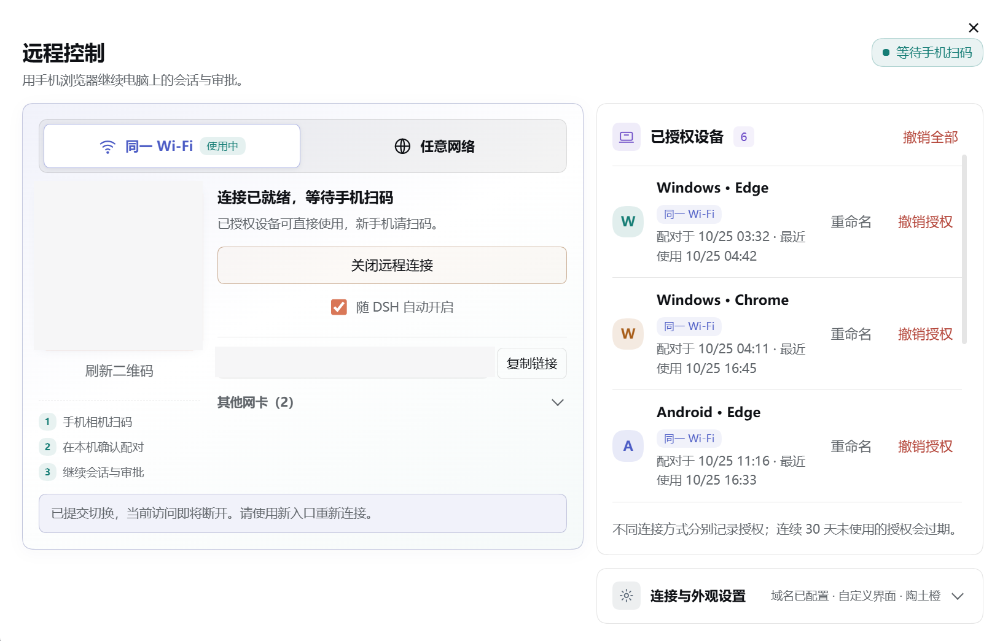
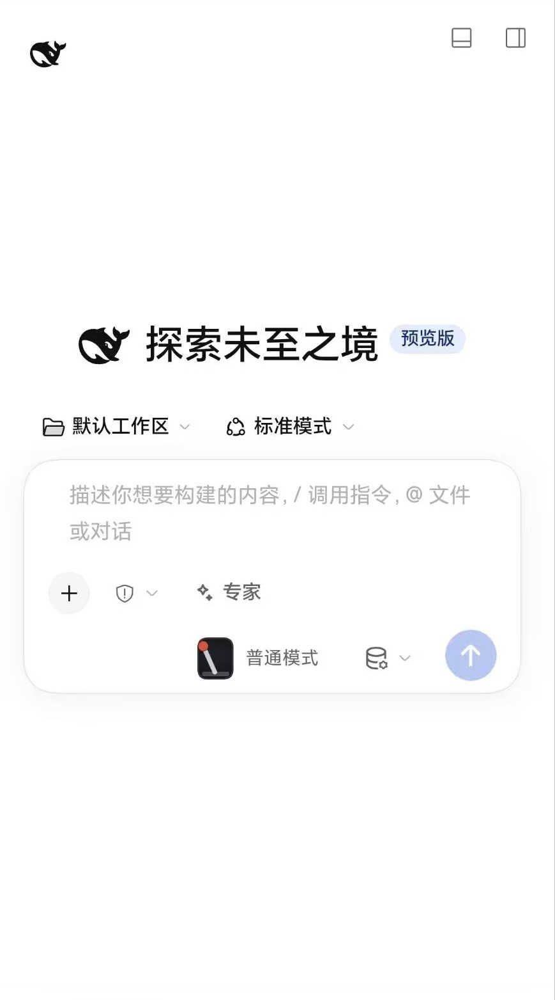

# DSH 远程连接

**远程连接** —— 用手机浏览器继续电脑上的 DeepSeek Harness（DSH）会话，支持扫码配对、消息发送、工具审批、附件与文件管理。

基于 [copylee711/dsh-remote-control](https://github.com/copylee711/dsh-remote-control) 修改，保留原项目 MIT 许可证。当前适配 **DSH 0.2.1-rc.3**。

## 界面预览





## 相比原项目的修改

- 将 DSH 相关依赖统一到 **0.2.1-rc.3**，解决 rc.2 / rc.3 混装造成模型插件无法加载的问题。
- 修复手机端“自定义界面 / 原生界面”切换：选择后立即打开对应界面并保存设置，不再错误跳回原生界面。
- 优化手机显示和交互，输入区、模型选择、主题切换、工作区入口等主要触控目标至少为 **44px**。
- 保留原生界面回退、中文输入、断线恢复、草稿保存和局域网 / 公网两种连接方式。
- 更新 rc.3 下的自动化交互回归测试，覆盖配对、聊天、审批、附件、文件、设置与界面切换。

## 安装

环境要求：Node.js 22.19+ 或 24+，DSH **0.2.1-rc.3**。

在 DSH 插件管理中添加：

```text
@winlin926/dsh-remote-connect
```

使用命令行安装：

```bash
dsh plugin --profile web add @winlin926/dsh-remote-connect@latest
```

DSH 桌面版和 `dsh web` 使用各自的配置，需要分别安装。

## 最简单的用法：同一 Wi-Fi

1. 手机和电脑连接同一个 Wi-Fi。
2. 在电脑上打开插件，选择 **同一 Wi-Fi**，开启远程连接。
3. 手机扫描二维码，在电脑上确认配对。
4. 配对完成后，直接在手机浏览器里继续会话。

此方式**不需要 SakuraFrp、frpc、公网域名或 HTTPS 证书**，也不要求手机安装 App。只在可信局域网中使用。

## 任意网络（公网）怎么用

想在外面用移动网络或其他 Wi-Fi 连接电脑时，需要自己的**固定 HTTPS 域名**和一条能访问电脑的转发通道。

可以把链路理解为：

```text
手机 → 你的 HTTPS 域名 → SakuraFrp / frpc / 反向代理 → 电脑的 127.0.0.1:43128
```

**SakuraFrp 不是必须安装的软件。** 它只是转发方式之一；已经使用其他 frpc、Nginx、Caddy 或内网穿透工具做好转发，就不需要再启动 SakuraFrp。

### 准备转发

1. 准备一个域名，并配置 HTTP 80、HTTPS 443 到本插件网关 `127.0.0.1:43128`。
2. 确保转发服务正在运行，证书与域名匹配。
3. 打开插件，选择 **任意网络**，在“连接与外观设置”填写域名，例如：

   ```text
   https://dsh.example.com
   ```

4. 开启远程连接，点击 **检测连通性**。显示可访问后，再扫码配对。
5. 公网新设备先输入电脑面板显示的 6 位连接密码，再在电脑上确认。

插件不会替你购买域名、创建隧道、启动 SakuraFrp 或修改系统服务。提示“公网入口不可达”时，通常说明转发服务未启动、域名解析不正确，或转发目标不是当前电脑的 `43128`。

使用 SakuraFrp 时，插件会按其 `FrpcWorkingDirectory` 约定部署证书；如面板提示重载隧道，需要在 SakuraFrp 中手动操作。也可使用其他反向代理自行管理证书。

## 两种手机界面

- **自定义界面**：插件针对手机优化的聊天界面。
- **原生界面**：DSH 官方 Web 界面。

进入 **设置与管理 → 远程连接与设备 → 连接与外观设置 → 手机界面**，选择后会立即打开并保存。切换不需要重新配对，会话数据不会因界面切换而分开。

`/?ui=custom` 和 `/?ui=native` 可临时预览指定界面，不改变保存的默认选择。

## 安全提示

已授权手机拥有与电脑本机相近的操作权限，包括管理设置、凭据和插件。只批准自己的设备，不要将配对链接、连接密码或授权设备信息发到公开位置；不再使用时及时撤销设备。

## 开发与验证

```bash
pnpm install
pnpm typecheck
pnpm test
pnpm build
```

## 致谢

感谢原项目 [copylee711/dsh-remote-control](https://github.com/copylee711/dsh-remote-control) 及其作者 Copy。原项目关于固定域名、密码和证书的设计还参考了 [dsh-remote-web-ui](https://github.com/zhu1090093659/dsh-web/tree/main/packages/dsh-remote-web-ui)、[DSH Remote](https://github.com/mrRisega/dsh-remote/tree/main/packages/dsh-remote-web) 与 [dsh-roam](https://github.com/winlin926/dsh-roam)。

## 许可证

MIT，保留原项目版权声明，见 [LICENSE](LICENSE)。
