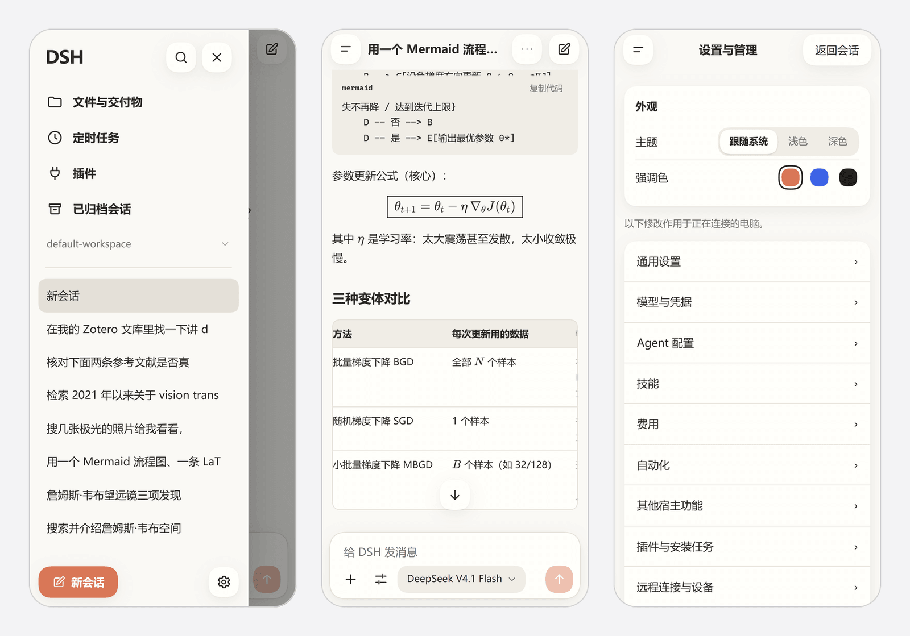

# dsh-remote-control

[](https://awesome-dsh-plugin.com)
[](https://www.npmjs.com/package/@copylee/dsh-remote-control)

DeepSeek Harness（DSH）的远程控制插件：手机扫码、在电脑上确认后，用手机浏览器继续电脑上的会话、处理审批、查看文件和管理设置。电脑上的桌面应用和 `dsh web` 界面保持原样。



## 功能

| 功能 | 说明 |
| --- | --- |
| 两种连接方式 | “同一 Wi‑Fi”：手机与电脑在同一网络内直连。“任意网络”：通过自己的固定公网域名和 frpc / 反向代理访问，不使用临时公共隧道 |
| 扫码配对、本机确认 | 新设备扫码后，电脑上确认配对请求。公网入口还需要电脑面板显示的 6 位连接密码 |
| 固定域名与证书 | 保存 HTTPS 域名、检测网关连通性，通过 Let’s Encrypt HTTP-01 申请和续期证书，按 SakuraFrp / frpc 约定部署 |
| 设备管理 | 查看已授权设备、重命名、撤销单台或全部设备；设备与电脑本机同权 |
| 手机界面 | 可选自定义移动界面或 DSH 原生界面；两套界面共用配对和授权 |
| 会话与管理 | 新建与继续会话、审批、附件、文件、宿主设置、凭据、插件、定时任务、技能和工作区 |
| 强调色 | 陶土橙、蓝色、黑色三选一，电脑面板、配对页和手机界面共用 |

## 安装

DSH 桌面版：**插件 → 添加插件**，输入 `@copylee/dsh-remote-control`，安装后启用。

命令行（`dsh web` 等其他 profile）：

```bash
dsh plugin --profile web add @copylee/dsh-remote-control@latest
```

桌面应用和 `dsh web` 使用各自的 profile，需要分别安装。DSH 最低版本为 0.2.1-rc.2，Node.js 22.19+ 或 24+。

## 使用

点击左侧栏底部的手机图标，或打开 **设置 → 远程控制**。

### 同一 Wi‑Fi

1. 选择“同一 Wi‑Fi”，点击“开启远程连接”。
2. 手机扫描二维码，在电脑上允许配对。
3. 手机进入自定义界面或原生界面，可在电脑面板更改默认选择。

手机与电脑需在同一局域网，路由器不能启用客户端隔离。Windows 防火墙可能拦截网关端口，需要手动允许；插件不会修改防火墙。

### 任意网络：固定公网域名

先准备自己的 HTTPS 域名和 frpc / 反向代理。插件不创建 Cloudflare Quick Tunnel、localhost.run 或其他临时公网地址。

1. 在面板填写固定公网域名，例如 `https://dsh.example.com`，保存。
2. 配置 frpc 的 HTTP 80 和 HTTPS 443 转发到插件所在电脑的 **127.0.0.1:43128**。公网监听端口固定为 43128，不能使用随机端口。
3. 点击“开启远程连接”。插件会自动检测一次域名连通性，运行期间每 2 分钟复查；也可以手动点“检测连通性”。成功表示域名返回的是当前远程控制网关，不只是某个能打开的网页。公网入口不可达时，面板和二维码下方会提示检查电脑上的 SakuraFrp / frpc 服务与隧道。
4. 手机扫描二维码，输入面板显示的 6 位连接密码，然后在电脑上允许配对。

固定域名不会因插件重启而变化。已授权设备可以继续使用原地址；二维码只用于添加新设备，有效期 5 分钟，点击二维码可刷新。

当前没有固定密码时会生成随机 6 位密码，重启插件后可能变化。可以在面板设为固定密码。修改密码或恢复随机密码会立即撤销所有设备授权，手机需要重新配对。

首次读取到旧版 `dsh-roam` 设置时，会迁移其固定域名、固定密码和 ACME 账户状态；原目录不删除、不改写。新配置按 profile 保存在 `$DSH_HOME/dsh-remote-control/<profile>/`。

## HTTPS 证书

- 证书使用 Let’s Encrypt HTTP-01；域名的 80 转发必须能到达插件的 43128。
- 证书与私钥按 `<域名>.crt` / `<域名>.key` 部署到 SakuraFrp 的 `FrpcWorkingDirectory`。
- 已有有效证书会直接识别，不会自动重新申请。剩余不足 30 天时进入续期范围，运行期间每 12 小时检查一次。
- 面板显示未申请、申请中、自签、有效期、过期和错误状态，也可以手动申请或续期。
- 新证书部署后如需重载 frpc，面板会提示；插件不自动重启 SakuraFrp 或修改系统服务。
- 私钥采用原子部署并收紧 Windows ACL。没有应用层端到端加密，TLS 在你的 frps / 反向代理处终止。

## 设置

| 选项 | 默认 | 说明 |
| --- | --- | --- |
| 连接方式 | 同一 Wi‑Fi | 同一 Wi‑Fi / 任意网络（固定域名） |
| 随 DSH 启动 | 关 | 启动时自动开启所选连接方式 |
| 固定公网域名 | 从旧配置迁移，否则空 | 仅 HTTPS origin，不包含路径或用户信息 |
| 连接密码 | 随机 6 位 | 可复制、设为固定或恢复随机；修改会撤销旧授权 |
| 电脑访问外网的代理 | 不使用 | 不使用 / 自动检测系统代理 / 手动填写；只用于域名检测和证书请求 |
| 手机界面 | 自定义界面 | 自定义界面 / 原生界面，刷新手机页面后生效 |
| 强调色 | 陶土橙 | 陶土橙 / 蓝色 / 黑色 |
| `gatewayPort`（插件配置项） | 自动 | 只影响局域网端口；公网固定使用 43128 |

代理只影响插件自己发出的外网请求，不修改系统代理，也不改变手机到 frps / 反向代理的路径。手动代理仅接受不带用户名密码的 HTTP(S) 地址。

## 安全说明

- **已授权的设备与电脑本机权限相同**，可以管理设置、凭据和插件。只批准自己信任的设备。
- 公网配对需要连接密码和本机确认，两者不互相替代。密码连续输错会限速，临时入口凭证有有效期。
- 固定域名、局域网地址和 Host 白名单分开校验；设备 Cookie 不会转发给 DSH Host，Host 凭据也不会发给手机。
- 修改密码、撤销设备或关闭连接会中断对应的 HTTP、WebSocket 和 SSE 会话。
- “同一 Wi‑Fi”使用 HTTP，只应在可信网络使用；公网应使用 HTTPS。
- 不在日志、截图或设备文件中保存设备密钥原文或连接密码。连接密码只显示给本机面板。

## 工作原理

```text
手机浏览器
   │  HTTPS 固定域名（frpc / 反向代理）或 HTTP 同一 Wi‑Fi
   ▼
认证网关（本插件；公网为 127.0.0.1:43128）
   │  连接密码 → 本机确认 → 设备 Cookie → 换用宿主凭据
   ▼
DSH Host 的 Web 服务与 Remote 接口
```

手机自定义界面由插件渲染；原生界面就是宿主的 Web 页面，不另加控件或布局。事件流统一经认证的 WebSocket 载体转发，保留事件顺序、`Last-Event-ID` 和重连。

对话里的 `file://` HTML 链接会在电脑端建立临时预览站点，手机新标签页通过当前 HTTP(S) 入口打开。HTML 的相对路径样式、脚本、图片及目录内链接均可使用，无需把文件复制到手机。预览使用随机地址、目录边界和沙箱隔离，空闲 2 小时、撤销设备或关闭连接后失效；不会把 DSH 的管理接口暴露给预览脚本。

更多实现对应关系见[功能清单](docs/features.md)和 [UI 规格](docs/ui-spec.md)。

## 开发

```bash
pnpm install
pnpm typecheck
pnpm test
pnpm build
node scripts/check-package.mjs
```

`pnpm qa:host` 在仓库的 `.qa/` 目录里启动隔离的 DSH Web profile；`pnpm qa:browser` 用本机 Chrome 跑远程界面回归。测试不访问真实用户配置，不自动申请真实证书。

本地联调：DSH 桌面版“添加插件”里填本仓库目录路径（以 link 方式安装），`pnpm build` 后重启 DSH 生效。

## 致谢

实现时参考了 [dsh-remote-web-ui](https://github.com/zhu1090093659/dsh-web/tree/main/packages/dsh-remote-web-ui)、[DSH Remote](https://github.com/mrRisega/dsh-remote/tree/main/packages/dsh-remote-web) 和 [dsh-roam](https://github.com/winlin926/dsh-roam) 的固定域名、密码和证书实现。

## 许可证

MIT
